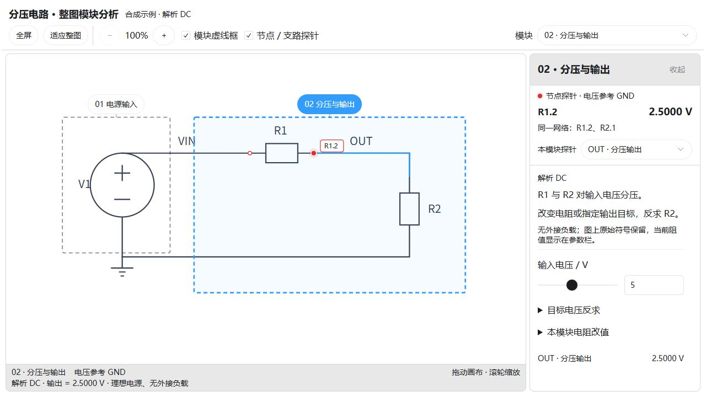
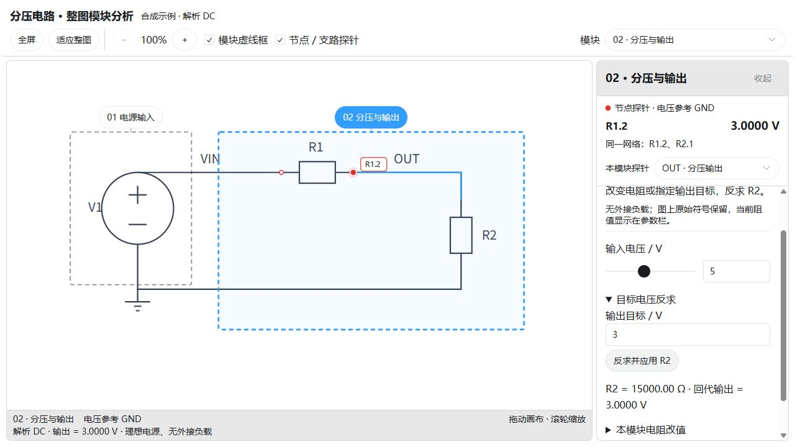

# 原理图交互分析

**保留完整原图，把电路分成可查看、可调参、可核对的功能模块。**

`schematic-interactive-analysis` 是一个 Codex 技能，包含原理图分析流程、交互画布模板、页面生成器和 DC 数值检查器。它帮助 AI 沿着原图解释电路：先看模块用途和连接关系，再选择节点、调整有模型的参数，观察计算结果或反求目标元件值。

技能版本：`2026-10-21.1` · [技能入口](SKILL.md) · [下载技能包](dist/schematic-interactive-analysis.skill) · [画布接口说明](references/canvas-template.md)

## 界面展示

下面是**仓库自带原创分压示例实际运行后的浏览器截图**，不是概念图，也不含客户原理图。示例采用理想直流电源、两只电阻和无外接负载的解析模型，不能作为其他电路的默认参数或模型。



整图始终保留。选择“分压与输出”模块后，可查看模块用途、适用条件和 OUT 节点读数。默认输入为 5 V，R1、R2 均为 10 kΩ，输出为 2.5 V。



在示例中指定 3 V 输出，保持输入 5 V 和 R1 = 10 kΩ，点击“反求并应用 R2”，得到 R2 = 15 kΩ，并用同一模型回代得到 3 V。这里展示的是参数变化后的模型计算，不是硬件实时采样。

## 可以做什么

| 能力 | 具体作用 |
| --- | --- |
| 整图模块分析 | 在原图上用虚线标出功能区域，保留原布局、位号及跨模块连线；点击模块查看用途和使用说明。 |
| 节点与支路探针 | 小红点按电气网络去重；显示相对参考地的电压、同网引脚，以及模型支持的支路电流和方向。接地网只作参考，不重复设置节点探针。 |
| 参数试算 | 由当前电路模型提供可调整参数；滑块、数值框、图上状态和结果同步更新，切换模块保留输入。 |
| 目标反求 | 模型提供对应操作时，可指定目标、固定条件和待求参数，再回代核对结果；不是任意电路的一键反求。 |
| 大画布查看 | 支持拖动、滚轮和按钮缩放、适应整图；宿主允许时支持全屏。模块详情独立滚动，顶部探针读数保持可见。 |
| 模型边界提示 | 区分解析计算、实际仿真和定性示意；缺模型、输入无效或结果越界时明确提示。 |
| 页面生成与 DC 检查 | 用固定模板生成交互页面；对已有 DC 数值快照核对 KCL、元件方程和功率平衡。 |

画布模板已经随技能提供。分析新电路时复用布局和交互，更换原图数据、模块划分及经过核对的模型，不需要从头重画一套界面。

## 适合的使用场景

- 讲清一页原理图中的供电、信号调理、采样或输出模块，以及它们之间的连接关系。
- 给已有依据的电路参数增加交互控件，比较修改前后的节点电压和支路电流。
- 在模型成立的范围内，按目标电压或其他物理量反求元件参数，并说明适用条件。
- 交付可操作的电路说明，让读者沿原图查看模块、探针和计算结果，而不只阅读一份文字分析。

## 安装与调用

下载 [技能包](dist/schematic-interactive-analysis.skill)，按 ZIP 文件解压，将其中的 `schematic-interactive-analysis` 文件夹放入 Codex 技能目录，通常为 `~/.codex/skills/`。

也可以直接克隆：

```sh
git clone https://github.com/Aaron-shi-bot/schematic-interactive-analysis.git ~/.codex/skills/schematic-interactive-analysis
```

已有旧版时先备份再更新；使用自定义技能目录时，以本机 Codex 配置为准。

提供原理图后，可以这样请求：

> 使用 $schematic-interactive-analysis 分析这份原理图。保留整图并用虚线标出功能模块，点击模块查看用途、参数、红色探针和计算结果；把缺少模型或接线不确定的地方标清楚。

若希望侧重某个问题，也可以补充：

> 保持原图，给输入电压和 R12 增加调节控件，观察输出变化。先说明模型成立的条件，再按目标输出反求阻值并回代核对。

## 运行仓库示例

需要 Python 3 和支持交互页面的现代浏览器。生成器与 DC 检查器使用 Python 标准库；在 Codex 中展示或导出独立页面时，还需当前环境可用的 `visualize` 技能及其渲染器。

从仓库根目录生成页面片段：

```sh
python scripts/build_canvas.py --data assets/canvas/example-data.json --model assets/canvas/example-model.js --destination build/example.fragment.html
```

生成可直接用浏览器打开的独立页面：

```sh
python scripts/build_canvas.py --data assets/canvas/example-data.json --model assets/canvas/example-model.js --destination build/example.fragment.html --standalone build/example.html --visualize-skill "<当前 visualize 技能目录>"
```

将占位路径替换为本机实际目录，然后打开 `build/example.html`。这是本页截图使用的原创两电阻分压示例，不需要部署服务器。

检查器另附一个完整 DC 数值快照示例：

```sh
python scripts/check_dc.py assets/dc-divider.example.json
```

这个命令检查已经计算好的输入数值，不负责求解电路。通过检查也不能证明原图识别、连接关系或器件模型正确。

## 仓库内容

| 路径 | 用途 |
| --- | --- |
| [SKILL.md](SKILL.md) | AI 读取原图、建模、交互和验算的工作流程。 |
| [assets/canvas/](assets/canvas/) | 固定画布模板、绘图与探针逻辑，以及原创示例数据和模型。 |
| [scripts/build_canvas.py](scripts/build_canvas.py) | 校验数据并生成页面片段，可配合当前 `visualize` 渲染器导出独立页面。 |
| [scripts/check_dc.py](scripts/check_dc.py) | 核对完整 DC 快照的数值一致性。 |
| [references/](references/) | 原图映射、模块画布、模型接口、建模与验证说明。 |
| [dist/](dist/) | 可迁移技能包。 |
| [release-manifest.json](release-manifest.json) | 版本与文件校验信息。 |

## 分析范围

本项目提供 **AI 分析流程与交互展示工具**，不是通用 EDA 编辑器、任意工程格式解析器或自带 SPICE 求解器。每份电路仍需核对拓扑、元件参数、模型和输入条件；复杂仿真需要实际可用的求解器及对应器件模型。

示例中的分压公式、阻值和电源条件只属于该示例。应用到新原理图时，应保留真实原图和未知部分，区分解析计算、已运行的仿真与定性说明，不把示例改几个标题就当成新电路的分析结果。

